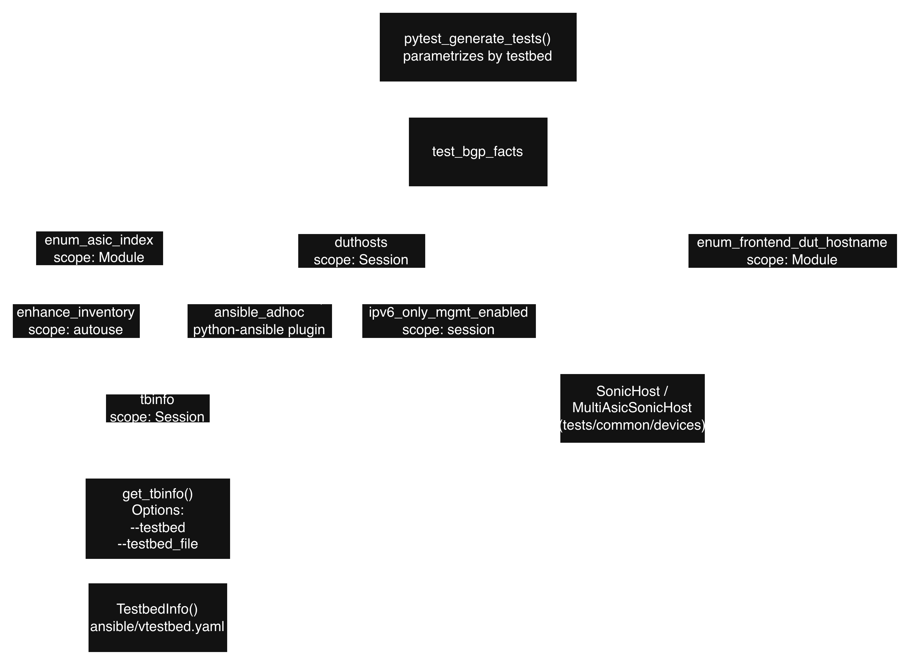

### Repository structure

```text
sonic-mgmt/
├── ansible/                  # Testbed definitions, inventory, deployment playbooks
│   ├── testbed.yaml          # physical testbeds
│   ├── vtestbed.yaml         # virtual (KVM) testbeds
│   ├── veos, veos_vtb, lab   # inventory files
│   ├── testbed-cli.sh        # topology operations
│   ├── vars/topo_*.yml       # topology definitions (t0, t1, ptf32 ...)
│   └── group_vars/, host_vars/
├── tests/                    # pytest tests
│   ├── conftest.py           # global options, core fixtures, pytest_plugins
│   ├── run_tests.sh          # wrapper that builds the pytest command
│   ├── common/
│   │   ├── devices/          # SonicHost, MultiAsicSonicHost, DutHosts classes
│   │   ├── fixtures/         # shared fixtures
│   │   ├── helpers/          # plain helper functions
│   │   ├── plugins/          # pytest plugins
│   │   └── testbed.py        # testbed file parsing
│   ├── bgp/, pfcwd/, acl/, qos/, ...   # test areas, one folder per feature
│   ├── ptftests/, saitests/  # PTF traffic scripts
│   └── scripts/, templates/
└── docs/                     # project documentation
```

### Ansible

[`ansible`](https://github.com/sonic-net/sonic-mgmt/tree/2225757eff4f243cc4fe6f385b2f516773c8a7dc/ansible) This folder contains codes for SONiC testbed deployment and setup.

- `vtestbed.yaml` - contains different testbed definitions.
- `veos`, `veos_vtb`, etc. - inventory files, host lists for DUTs, servers and VMs.
- `group_vars`, `host_vars` - contains variables for each group and host such as credentials and connection details.
- `vars/` - directory full of topologies (t0, t1, t2, etc).
- `testbed-cli.sh` - the main script for different topology operations. For example, adding and removing topologies, deploying topology.
- `templates/` - config templates.
- `testbed_add_vm_topology.yml` and `testbed_remove_vm_topology.yml` - playbooks used by `testbed-cli.sh` to add or remove a topology.
- `config_sonic_basedon_testbed.yml` and `deploy_config_on_testbed.yml` - playbooks that push configuration to the DUT.

##### vars/

[`vars/`](https://github.com/sonic-net/sonic-mgmt/tree/master/ansible/vars)

This directory contains a lot of different topologies such as t0, t1 and t2.

Each topology file contains the topology configuration, including host interfaces, VMs, DUT settings and BGP configuration.

##### vtestbed.yaml

[`vtestbed.yaml`](https://github.com/sonic-net/sonic-mgmt/blob/master/ansible/vtestbed.yaml)

This is the testbed definition file for the virtual testbed.

The fields of each entry:

- `conf-name` and `group-name` - the testbed name and its group.
- `topo` - the topology name which refers to a file in `ansible/vars/topo_*.yml`.
- `ptf_image_name`, `ptf`, `ptf_ip` - the PTF container.
- `server` - the server that runs the topology.
- `dut` - the device under test hostname. Can be more than one.
- `inv_name` - the inventory file name to use. Refers to `ansible/*`.

##### testbed-cli.sh

[`testbed-cli.sh`](https://github.com/sonic-net/sonic-mgmt/blob/master/ansible/testbed-cli.sh)

This script is using Ansible playbooks to operate with topologies.

The main operations:

- `start-vms` / `stop-vms <server>` - used to start or stop neighbour VMs on a server.
- `add_topo` - deploys a topology for the specified testbed on a server.
- `remove_topo` - removes the topology for the specified testbed on a server.
- `deploy_mg` - deploys minigraph to the DUT.

### Tests

[`tests`](https://github.com/sonic-net/sonic-mgmt/tree/master/tests)

This folder contains all tests and the running test script.

`conftest.py` - The central pytest file. It holds CLI options, `tbinfo`, `duthosts`, `ptfhost`, the `enum_*` fixtures and `pytest_generate_tests`.

`pytest.ini` - Config for the run.

`run_tests.sh` - The wrapper script around pytest.

`test_pretest.py`, `test_posttest.py` - They prepare the DUT before a run and clean up and collect diagnostics after it.

Test areas (one folder per feature): `bgp/`, `acl/`, `qos/`, `pfcwd/`, `route/`, `vlan/`, `fdb/`, and about 100 more. A test is a `test_*.py` file inside its feature folder.

[`common/`](https://github.com/sonic-net/sonic-mgmt/tree/master/tests/common) - the shared library.

- `devices/` - the host classes (`SonicHost`, `MultiAsicSonicHost`, `DutHosts`, `PTF`).
- `fixtures/` - shared fixtures.
- `helpers/` - plain helper functions.
- `plugins/` - pytest plugins.

`ptftests/`, `saitests/`, `acstests/` - PTF scripts that send and receive packets on the PTF host. They are not pytest tests.

[`./run_tests.sh`](https://github.com/sonic-net/sonic-mgmt/blob/master/tests/run_tests.sh)

This script is a wrapper around pytest.

It builds the right `pytest` command lines and runs them in three stages.

1. First `setup_environment`
   - Sets default variables.
   - Exports Ansible variables.
   - Kills any running pytest and ansible-playbook processes.

2. Option parsing `getopts`
   - Parses the options passed through the `./run_tests.sh` script.

3. Builds the pytest command `setup_test_options`
   - It builds the list of test files and common options.

Example `./run_tests.sh` command:

```bash
./run_tests.sh -n vms-kvm-t0 -d vlab-01 -c bgp/test_bgp_fact.py -f vtestbed.yaml -i ../ansible/veos_vtb -u
```


### Docs

[`docs`](https://github.com/sonic-net/sonic-mgmt/tree/master/docs)

Holds the project documentation for sonic-mgmt. It explains how to set up testbeds, how to write and run tests, and what each test is meant to verify.

Its main subfolders:

- `docs/testbed/`: guides for building and configuring testbeds.
- `docs/tests/`: guides for writing, organising and running pytest tests.
- `docs/ansible/`: documentation for the Ansible deployment and test code.
- `docs/testplan/`: test plans that describe what each feature test should verify, such as BGP and ACL.

### Test bgp facts

Path to test: [`sonic-mgmt/tests/bgp/test_bgp_fact.py`](https://github.com/sonic-net/sonic-mgmt/blob/master/tests/bgp/test_bgp_fact.py)

The test is a thin wrapper and the main logic is in [`run_bgp_facts`](https://github.com/sonic-net/sonic-mgmt/blob/master/tests/common/helpers/bgp.py#L143) function in `tests/common/helpers/bgp.py`.

#### How the DUT is selected and accessed

`run_tests.sh -d <dut>` passes the selected DUT to pytest as `--host-pattern` and `-n <testbed>` specifies the testbed.

`pytest_generate_tests` checks if the test uses `enum_frontend_dut_hostname` and creates a separate test instance for each frontend DUT (and ASIC if `enum_asic_index` is used). If a specific DUT is selected, only that DUT is used.

We can access DUT by passing `enum_frontend_dut_hostname` as an index of `duthosts` like this:

```python
duthosts[enum_frontend_dut_hostname]
```

After that we can retrieve the corresponding `MultiAsicSonicHost` object (`duthost`).

#### What it tests

The test checks if the DUT BGP state matches the configured state. For each ASIC of each DUT.

- Sessions are up: each neighbour in `bgp_facts` is `established`.
- Local ASN is correct.
- STATE_DB agrees: `NEIGH_STATE_TABLE|<nbr>` shows `Established` and the right `peerType` (`i-BGP` if the remote and local ASN are equal, otherwise `e-BGP`). It polls with `wait_until(30, 5, 0, ...)` because `bgpmon` updates this table with a lag.
- Config matches runtime: compare the BGP neighbors name with config DB BGP neighbor name. Also compare the BGP neighbors ASN with config DB.

**PASS**: every neighbor is `established`, local AS correct, STATE_DB `NEIGH_STATE_TABLE` reaches `Established` + correct `peerType` within 30 s, names/ASNs match CONFIG_DB.

**FAIL**: any `assert` in `run_bgp_facts` fails, also fixture errors.

**SKIP**: only via markers - `pytest.mark.topology('any','t0-sonic','t1-multi-asic')` (skipped if `--topology` doesn't match), `pytest.mark.device_type('vs')` (skipped if `--device_type` differs).

#### Setup and teardown

The required fixtures initialize the DUT host objects and provide testbed information before the test runs.

The test itself only reads information from the DUT. Fixture teardown is handled by pytest after the test finishes.

#### Testbed or topology dependencies

The test uses topology markers:

- `pytest.mark.topology('any','t0-sonic','t1-multi-asic')`
- `pytest.mark.device_type('vs')`

The test is intended to run with a matching testbed and device type.

##### Fixtures dependency diagram for the BGP facts test



### Fixture Scopes

Scopes define how long a fixture is reused.

Available scopes: `function` (per test), `class` (per test class), `module` (per Python file), `package` (per package), `session` (once per pytest run).

### Autouse

`autouse=True` – makes a fixture run automatically without explicitly adding it to the test arguments. For example, `enhance_inventory` in `conftest.py`.

### Yield

`yield` – separates fixture execution into two parts: setup (before `yield`) and teardown (after `yield`).

### Fixture explanation

`test_bgp_facts` uses 3 fixtures: `duthosts`, `enum_asic_index` and `enum_frontend_dut_hostname`.

#### duthosts

[`duthosts`](https://github.com/sonic-net/sonic-mgmt/blob/master/tests/conftest.py#L847)

The fixture contains `DUTs` hosts defined in `testbed`.

Also it uses `enhance_inventory`, `ansible_adhoc`, `tbinfo`, `request`, `ipv6_only_mgmt_enabled` fixtures.

To collect DUT hosts it uses `DutHosts` class.

[`DutHosts`](https://github.com/sonic-net/sonic-mgmt/blob/master/tests/common/devices/duthosts.py#L12)

This is the container of all DUTs. It behaves like a list: it supports `duthosts[0]` and `duthosts['sonic1']`.

#### enhance_inventory

The [`enhance_inventory`](https://github.com/sonic-net/sonic-mgmt/blob/master/tests/conftest.py#L653) fixture allows passing multiple inventory files separated by commas instead of just one. If `trim_inv` is enabled, it also trims the inventory to keep only the required DUTs, removing unnecessary hosts.

#### ansible_adhoc

[`ansible_adhoc`](https://github.com/sonic-net/sonic-mgmt/blob/master/tests/common/plugins/ansible_fixtures.py#L23)

It returns `init_host_mgr`, which initializes and returns the Ansible Host Manager using the current pytest configuration. It allows us to access DUTs defined in the inventory.

It returns a function that can be used to obtain an Ansible host object for a specific DUT, through which we can execute Ansible modules such as `shell`, `command`, and `bgp_facts`.

#### tbinfo

[`tbinfo`](https://github.com/sonic-net/sonic-mgmt/blob/master/tests/conftest.py#L743)

Calls `get_tbinfo` to obtain testbed information.

[`get_tbinfo`](https://github.com/sonic-net/sonic-mgmt/blob/master/tests/conftest.py#L725)

This is the helper function to create and return testbed information. It requests `--testbed` and `--testbed_file` from config and calls `TestbedInfo` class.

[`TestbedInfo`](https://github.com/sonic-net/sonic-mgmt/blob/master/tests/common/testbed.py#L26)

This class contains helper methods to parse the testbed file and returns a `TestbedInfo` object.

#### ipv6_only_mgmt_enabled

Fixture that checks and configures IPv6 management mode.

If `--ipv6_only_mgmt` or `-6` is passed to pytest, this enables IPv6-only management mode where DUT `mgmt_ip` will use the IPv6 address.

#### enum_asic_index

`enum_asic_index` returns an identifier/index of ASIC.

For a single-ASIC DUT it uses the repository default ASIC_ID `DEFAULT_ASIC_ID`.

For a multi-ASIC DUT it uses the inventory `ASICS_PRESENT` value if it is available. If not, it makes indices from 0 up to the configured ASIC count.

#### enum_frontend_dut_hostname

Fixture that gives a test the hostname of frontend DUT.

Returns hostname string per test case.

### Test lifecycle

Before pytest: `run_tests.sh`

It parses the options, kills stale pytest and Ansible processes. Then it runs the pretest stage, the tests, and the posttest stage.

Startup (`tests/conftest.py`)

`pytest_addoption` registers `--testbed`, `--testbed_file`, `--inventory`, `--host-pattern` and the others that we've put in `./run_tests.sh`.

`pytest_configure` and `pytest_sessionstart` set up the session.

Collection and parametrization

`pytest_generate_tests` checks which fixtures the test uses and generates test instances based on the testbed configuration. For example, it creates separate instances for different DUTs and ASICs.

Fixture setup

Pytest initializes the required fixtures according to their scope.

`duthosts` creates a `DutHosts` object, which contains `MultiAsicSonicHost` instances for the selected DUTs. During initialization, it connects to the DUTs through Ansible and gathers device facts.

Other autouse fixtures and plugins also perform their setup here.

Test execution

The `test_bgp_facts` test compares BGP information from FRR, STATE_DB and CONFIG_DB. It only reads information from the DUT.

Teardown and report

After the test finishes, pytest tears down the fixtures in reverse order of their scope.

Lifecycle summary:

`run_tests.sh` (env, args) -> pretest (`test_pretest.py`) -> pytest start (`pytest_addoption`, `pytest_configure`, `pytest_sessionstart`) -> collection + `pytest_generate_tests` + marker skips -> session fixtures (`tbinfo`, `duthosts`) -> module fixtures (`enum_*`, setup) -> function fixtures -> test body -> teardown after `yield` in reverse order -> report/junit -> posttest (`test_posttest.py`).

### Example commands (from `sonic-mgmt/tests`)

For running I use my already running topology.

##### collect-only

Command:

```bash
./run_tests.sh -n vms-kvm-t0 -d vlab-01 -c bgp/test_bgp_fact.py -f vtestbed.yaml -i ../ansible/veos_vtb -e "--collect-only"
```

Output:

```text
<Package tests>
  <Dir bgp>
    <Module test_bgp_fact.py>
      <Function test_bgp_facts[vlab-01-None]>
```

##### run test by filename

Command:

```bash
./run_tests.sh -n vms-kvm-t0 -d vlab-01 -c bgp/test_bgp_fact.py -f vtestbed.yaml -i ../ansible/veos_vtb
```

##### run test by ID

Command:

```bash
./run_tests.sh -n vms-kvm-t0 -d vlab-01 -c bgp/test_bgp_fact.py::test_bgp_facts[vlab-01-None] -f vtestbed.yaml -i ../ansible/veos_vtb
```

##### run test with debug mode

`-m debug`

```bash
./run_tests.sh -n vms-kvm-t0 -d vlab-01 -c bgp/test_bgp_fact.py::test_bgp_facts[vlab-01-None] -f vtestbed.yaml -i ../ansible/veos_vtb -m debug
```
